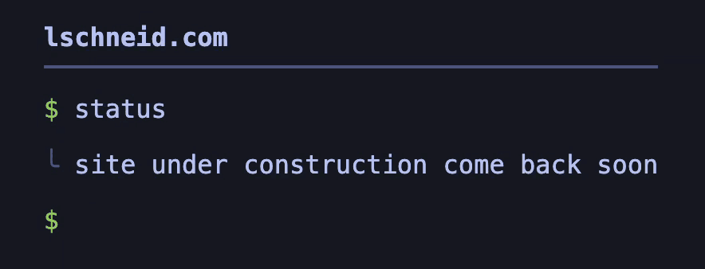

# lschneid.com

Live at [lschneid.com](https://lschneid.com).

A little portfolio website I made to showcase personal projects, university studies and solutions I worked on at my jobs. Since many of my interests are more low-level and I just like the overall aesthetics of TUIs, I figured why not make my website look like one too.

>[!NOTE]
>Tbh there isn't much to see yet. Until the website's MVP is ready I just added a little "under construction" teaser.
>
>

## License

The source code is licensed under the [MIT License](LICENSE).

The content of the site (texts, images, CV and other personal
material) is not covered by this license. All rights reserved.
